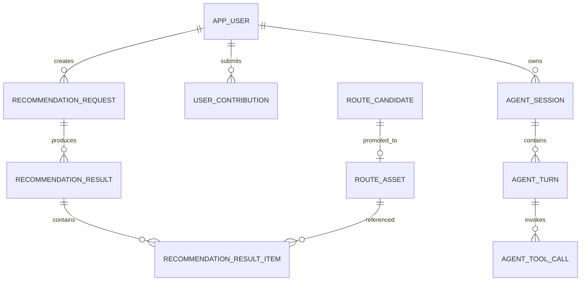

# MySQL 持久层设计与改造计划

日期：2026-09-22  
主导岗位：项目经理 / Principal Software Architect  
状态：规划稿 v1  
目标：将 JSON / CSV / 文件型数据替换为 MySQL 正式持久层

## 1. 目标

建立以 MySQL 为唯一业务数据权威源的持久层，并逐步替换当前直接读写 `outDoor/data/` 文件的 Repository。

改造后：

```text
Java 或 Python Domain Service
        ↓
Repository Port
        ↓
MySQL Adapter
        ↓
MySQL
```

Agent 不直接访问 MySQL，必须通过业务 API 或受控 Tool 调用领域能力。

## 2. 当前证据和问题

当前存在：

- `RecommendationPoolRepository` 直接读写 `recommendation_pool_v0.1.json`；
- `SearchEventRepository` 直接读写 `search_events_v0.1.json`；
- 其他 Repository 仍依赖 JSON / CSV；
- `RecommendationTrackingRepository` 仅对部分用户数据提供 JDBC 逻辑；
- `V1__db1_intelligent_recommendation.sql` 是 MySQL 兼容 DDL 草案；
- `pom.xml` 已包含 MySQL Connector，但没有完成统一数据访问；
- `application.yml` 的 JDBC 配置目前偏向可选用户数据持久化；
- Docker 仍将 `outDoor/data` 复制到镜像。

客观结论：

> 当前项目不是“已有完整 MySQL 持久层”，而是“已有 MySQL 迁移起点，但运行时仍以文件数据为主”。

## 3. 设计原则

1. MySQL 是正式环境 SoT；
2. JSON / CSV 只能作为迁移输入、备份或测试 fixture；
3. 业务规则不写在 SQL 或 Repository 中；
4. Repository 只负责持久化；
5. Schema 通过版本化迁移管理；
6. 任何写入必须经过明确业务用例；
7. 业务域必须有唯一 owner；
8. 迁移必须支持对账和回滚；
9. Agent 不直接连接数据库；
10. 不用一张大 JSON 表替代所有业务表。

## 4. 目标业务域

### 4.1 路线资产域

建议表：

```text
route_asset
route_asset_annotation
route_asset_source
route_asset_evidence
route_asset_status_history
route_asset_media
```

核心字段：

```text
route_asset
- id
- public_id
- shortline_id
- title
- city
- description
- difficulty
- duration_minutes
- distance_km
- elevation_gain
- family_suitable
- status
- recommendation_enabled
- trust_level
- completeness_score
- created_at
- updated_at
```

### 4.2 推荐域

保留并完善现有 DDL 方向：

```text
recommendation_request
recommendation_result
recommendation_result_item
recommendation_feedback
recommendation_policy_version
recommendation_explanation
```

要求：

- 记录请求快照；
- 记录结果快照；
- 记录规则 / 算法版本；
- 结果项绑定路线资产；
- 推荐解释和风险提示可审计。

### 4.3 用户域

```text
app_user
user_profile
user_preference
user_profile_feature
user_behavior_event
```

偏好和特征必须区分：

- 用户明确设置；
- 系统从行为推断；
- 有效期；
- 置信度；
- 来源。

### 4.4 用户贡献域

```text
user_route_submission
user_route_feedback
user_contribution
user_contribution_status_history
```

要求：

- 保存原始提交；
- 保存治理状态；
- 保存处理意见；
- 支持转为候选或路线资产；
- 不允许 Agent 直接改变审核结果。

### 4.5 候选治理域

```text
route_candidate
route_candidate_source
route_candidate_status_history
explore_draft
candidate_route_asset_link
```

要求：

- 来源可追溯；
- 状态可审计；
- 候选与正式路线资产分离；
- 合并、忽略、转资产均有记录。

### 4.6 Agent 运行域

```text
agent_session
agent_turn
agent_tool_call
agent_artifact
agent_feedback
```

该域由 Python Agent owner 管理，但仍通过 MySQL 正式持久化。

## 5. 关系和所有权



唯一写入原则：

| 域 | 迁移前 | 迁移后 |
|---|---|---|
| 路线资产 | Java Service | Python Domain Service |
| 推荐结果 | 当前 Java 推荐 owner | Python 推荐 owner |
| 用户贡献 | Java Service | Python Domain Service |
| Agent 运行域 | 不存在 / 新建 | Python Agent |
| Schema | 迁移 owner | 统一迁移工具 |

## 6. 迁移策略

### 阶段 D0：数据盘点

- [ ] 清点所有 `outDoor/data` 文件；
- [ ] 记录文件格式、字段、主键候选、来源、更新时间；
- [ ] 识别重复、废弃、冲突记录；
- [ ] 识别当前代码对每个文件的读写入口；
- [ ] 输出文件到表的映射矩阵。

验收：

- 所有运行时读取文件都有 owner 和替代表；
- 没有未识别的正式写入文件。

### 阶段 D1：Schema 设计和迁移工具

- [ ] 将现有 DDL 草案拆分为按域迁移；
- [ ] 选择并启用版本化迁移工具；
- [ ] 增加索引、唯一键、外键和状态字段；
- [ ] 为 JSON 字段定义大小和查询边界；
- [ ] 为审计和时间字段统一规范；
- [ ] 为迁移脚本建立回滚或补偿策略。

建议：

- 结构化查询字段使用普通列；
- 不确定、低频扩展字段使用 JSON；
- 不把全部路线数据塞进一个 JSON 列；
- 不用 ORM 模型直接作为前端 DTO。

### 阶段 D2：导入和对账

- [ ] 编写 JSON / CSV 导入工具；
- [ ] 导入到 staging 表或迁移批次；
- [ ] 执行字段、数量、唯一性、引用完整性检查；
- [ ] 生成导入报告；
- [ ] 对关键路线做人工抽样；
- [ ] 备份原始 data 文件到项目外部位置。

### 阶段 D3：Repository 替换

迁移顺序：

```text
SearchEventRepository
→ MapEnrichmentCacheRepository
→ RecommendationPoolRepository
→ ExternalRouteCandidateRepository
→ ExploreDraftRepository
→ RouteAssetAnnotationRepository
→ UserRouteContributionRepository
→ AdminSettingsRepository
→ Verification / Grade / Gate repositories
```

每个 Repository 迁移必须：

- 保留原有 Service 接口语义；
- 不把 SQL 规则泄露到 Controller；
- 有 MySQL 集成测试；
- 有旧数据对账；
- 有失败回退或恢复策略。

### 阶段 D4：切换运行时 SoT

推荐切换路径：

```text
文件只读 + MySQL 双读对照
→ MySQL 主读 + 文件只读备份
→ MySQL 主读写
→ 停止运行时依赖 data 文件
```

禁止未经验证直接删除 `outDoor/data`。

### 阶段 D5：Python 持久层接管

仅在某业务域完成 owner 切换后：

- Python Repository 接入 MySQL；
- Java 停止该域正式写入；
- 运行新旧结果对照；
- 再切换该域 API 流量。

## 7. 事务与一致性

必须明确：

- 推荐请求、结果和结果项的写入边界；
- 用户贡献状态变更和历史记录是否同事务；
- 候选转路线资产是否需要事务；
- Agent turn 与 tool call 是否允许异步最终一致；
- 地图缓存是否允许丢失；
- 重试是否幂等。

建议：

- 业务主数据使用事务；
- 外部 API 结果使用缓存和幂等键；
- Agent 日志允许异步写入，但不能影响主推荐结果；
- 状态变更必须有历史表或审计事件。

## 8. 索引与查询要求

优先为以下查询建立索引：

- 可推荐路线按状态查询；
- 城市 / 地理范围 / 难度筛选；
- 用户贡献按状态和时间查询；
- 候选按来源和治理状态查询；
- 推荐请求和结果按用户 / session / 时间查询；
- Agent session / turn 按时间和状态查询。

如果后续引入地理查询：

- 先确认 MySQL 版本和空间索引能力；
- 不在迁移早期自定义复杂地理算法；
- 先以坐标列 + 外部地图服务完成最小路径；
- 有规模证据后再升级地理索引。

## 9. 数据质量门禁

导入和切换前至少验证：

- 主键唯一；
- 外键引用完整；
- 状态枚举合法；
- `recommendation_enabled` 与审核状态一致；
- 路线坐标格式正确；
- 时间字段不为空或有明确默认；
- 真实图片状态符合“审核通过才能展示”规则；
- 推荐结果项都能回溯路线资产；
- 原始文件和数据库记录可对账。

## 10. 风险

| 风险 | 影响 | 应对 |
|---|---|---|
| 文件数据重复或脏数据 | 高 | staging 导入、规则校验、抽样复核 |
| 双写不一致 | 高 | 每域唯一 owner，避免长期双写 |
| Schema 过早锁死 | 中 | 稳定字段列化，扩展字段有限使用 JSON |
| 数据库变更无回滚 | 高 | 迁移脚本版本化、外部备份、演练 |
| Agent 直接查库 | 高 | Agent 只能调用领域 API / Tool |
| Docker 仍依赖 data 文件 | 高 | MySQL 主读验证后再移除 COPY |

## 11. MySQL 改造任务清单

### 基础任务

- [ ] 建立数据文件清单；
- [ ] 建立文件-表-Repository 映射；
- [ ] 确定 MySQL 版本；
- [ ] 确定迁移工具；
- [ ] 确定本地、测试、生产连接配置；
- [ ] 建立数据库备份和恢复说明。

### 业务任务

- [ ] 路线资产域迁移；
- [ ] 推荐域迁移；
- [ ] 用户贡献域迁移；
- [ ] 候选治理域迁移；
- [ ] 管理配置域迁移；
- [ ] Agent 运行域迁移。

### 验证任务

- [ ] Repository 集成测试；
- [ ] 导入对账；
- [ ] 新旧推荐结果对比；
- [ ] 状态流回归；
- [ ] 并发写入测试；
- [ ] 备份恢复测试；
- [ ] QA / diagnostician / reviewer。

## 12. 反向思考卡

- 当前身份：项目经理 / Principal Software Architect。
- 用户要求：制定 MySQL 持久层设计和改造计划。
- 客观判断：当前已有 MySQL DDL 起点，但未形成运行时 MySQL SoT。
- 阻塞项：数据文件清单、字段映射、迁移工具、唯一 owner 尚未完成。
- 建议：先 D0/D1 盘点和 Schema 设计，再做导入、Repository 替换和运行时切换。
- 是否建议下一步：建议先做只读盘点和迁移基线，不建议直接修改正式数据库。

