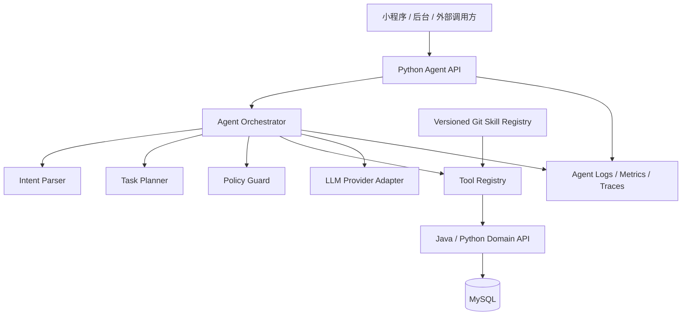

# Agent 智能体产品设计与改造计划

日期：2026-09-22  
主导岗位：项目经理 / Agent 架构师  
状态：规划稿 v1  
目标：建立 Python 独立 Agent 服务，并支持后续 Git Skill 扩展

## 1. 产品定位

Agent 不是普通聊天入口，而是：

> 面向户外出行决策的智能推荐与规划助手，根据用户的地点、时间、同行人、活动偏好和风险约束，调用可信业务能力，生成可解释、可执行、可回溯的户外推荐结果。

产品价值顺序：

```text
可信事实
→ 是否适合
→ 为什么推荐
→ 如何出发
→ 风险和备选
```

不以“回答像不像人”为首要目标。

## 2. 目标用户

### 2.1 小程序用户

需求示例：

- “周末深圳周边适合带孩子徒步的地方”
- “想找新手可以走的路线，开车不要超过两小时”
- “今天下雨，附近还有适合去的户外地点吗”
- “帮我安排一个半日徒步行程”

### 2.2 后台运营人员

需求示例：

- “哪些路线字段缺失最多？”
- “把用户贡献按路线分组”
- “哪些候选路线可能重复？”
- “这条路线为什么没有进入推荐？”

后台 Agent 只提供分析和建议，不能绕过现有治理状态机自动发布。

### 2.3 未来外部调用方

- 第三方客户端；
- 独立活动工具；
- 定时任务；
- 内容生产或运营工具。

因此 Agent API 不得绑定微信小程序页面字段。

## 3. MVP 产品范围

### 3.1 首个闭环

```text
自然语言需求
→ 意图结构化
→ 查询内部可推荐路线
→ 读取路线事实和证据
→ 进行适配度解释
→ 返回结构化推荐卡片
```

### 3.2 MVP 输出

每条推荐至少包含：

- 路线 ID；
- 名称；
- 适合原因；
- 关键事实；
- 难度；
- 时长 / 距离；
- 风险提示；
- 信息缺失；
- 证据来源；
- 是否可直接查看详情。

### 3.3 MVP 不做

- 自动预订；
- Agent 自动审核和发布；
- Agent 直接写路线资产；
- 任意 Git 仓库运行时安装；
- 多 Agent 自主协作；
- 长期记忆；
- 未经核验的自由联网推荐；
- 以模型生成内容替代路线事实。

## 4. 目标服务架构



## 5. 服务边界

### 5.1 Python Agent 负责

- 意图解析；
- 任务规划；
- 工具选择；
- Skill 编排；
- 结果解释；
- 会话和 Agent 运行记录；
- 超时、重试和降级；
- 模型 Provider 切换；
- 外部 Skill 的版本和权限管理。

### 5.2 Java / Python Domain 负责

- 路线是否可推荐；
- 路线状态；
- 审核状态；
- 可信度；
- 推荐规则；
- 用户贡献状态；
- 候选转换；
- 正式数据写入；
- 业务事务；
- 地图和天气事实的缓存策略。

### 5.3 MySQL 负责

- 业务事实；
- 路线资产；
- 推荐快照；
- 用户贡献；
- Agent 运行审计；
- 状态历史；
- Skill 版本和启用状态的持久化。

## 6. API 设计

### 6.1 对外 Agent API

```http
POST /v1/recommendations
POST /v1/sessions
POST /v1/sessions/{sessionId}/turns
GET  /v1/sessions/{sessionId}
GET  /v1/health
```

请求示例：

```json
{
  "message": "周末深圳周边适合带孩子徒步的地方",
  "actor": {
    "type": "user",
    "id": "optional"
  },
  "channel": "miniprogram",
  "context": {
    "origin": {
      "label": "深圳"
    },
    "preferences": {}
  },
  "options": {
    "stream": false
  }
}
```

响应示例：

```json
{
  "requestId": "agent_req_001",
  "intent": {
    "activityType": "hiking",
    "difficulty": "easy",
    "companions": ["children"],
    "origin": "深圳"
  },
  "recommendations": [
    {
      "routeId": "route_001",
      "title": "示例路线",
      "fitScore": 87,
      "reasons": ["难度适中", "符合出行范围", "具备亲子标签"],
      "facts": {},
      "risks": [],
      "evidence": []
    }
  ],
  "fallback": false,
  "missingInformation": []
}
```

### 6.2 内部业务 Tool API

第一阶段：

```text
search_outdoor_routes
get_route_detail
get_route_evidence
check_route_eligibility
get_map_enrichment
record_agent_event
```

后续：

```text
check_weather_risk
build_half_day_plan
build_day_trip_plan
analyze_user_contribution
detect_route_missing_fields
suggest_candidate_merge
```

Tool 返回必须是结构化 JSON，并包括：

- `data`；
- `source`；
- `verifiedAt`；
- `warnings`；
- `degraded`；
- `errorCode`。

## 7. Agent 决策边界

### 允许

- 选择工具；
- 组合只读信息；
- 生成适配度解释；
- 生成风险提示；
- 建议缺失信息；
- 生成行程草案；
- 建议后台人员处理顺序。

### 禁止

- 直接访问 MySQL；
- 直接访问 Repository；
- 直接修改路线状态；
- 自动发布未审核路线；
- 把模型生成内容当作事实；
- 在无证据时补造开放时间、票价、距离或安全结论；
- 动态执行未经审核的 Git Skill。

## 8. Git Skill 扩展设计

建议结构：

```text
agent/
├── skills/
│   ├── registry.yaml
│   ├── builtin/
│   └── external/
├── tools/
├── policies/
└── tests/
```

Skill Registry 示例：

```yaml
skills:
  - name: outdoor-route-planner
    source: git
    repository: https://github.com/example/outdoor-route-planner
    ref: v1.2.0
    digest: sha256:replace-me
    enabled: false
    permissions:
      - read_route_data
      - read_map_data
```

引入外部 Skill 前必须：

1. 固定 commit / tag；
2. 审查代码和依赖；
3. 声明权限；
4. 定义输入输出契约；
5. 限制网络、文件和数据库权限；
6. 设置超时和资源限制；
7. 记录版本和调用日志；
8. 支持禁用和回滚；
9. 用测试样例验证结果；
10. 不把密钥注入 Skill 上下文。

## 9. Agent 产品建设阶段

### 阶段 A0：产品和安全基线

- [ ] 确认首个用户场景；
- [ ] 明确小程序用户和后台运营两个入口；
- [ ] 锁定 MVP 非目标；
- [ ] 定义可信事实、解释和风险的输出口径；
- [ ] 确认模型供应商、区域、成本和数据处理边界；
- [ ] 定义 Agent 禁止动作。

验收：

- 产品需求、非目标、验收标准完整；
- 不把“会聊天”当成产品验收标准。

### 阶段 A1：Python Agent Runtime

- [ ] 建立 Python Agent 服务；
- [ ] 建立统一请求 / 响应模型；
- [ ] 建立会话、turn、tool call 模型；
- [ ] 建立 Provider Adapter；
- [ ] 建立 Tool Registry；
- [ ] 建立结构化输出校验；
- [ ] 建立超时、重试和 fallback；
- [ ] 建立健康检查、日志和指标。

### 阶段 A2：接入现有推荐能力

- [ ] 接入 Java / Python Domain API；
- [ ] 实现 `search_outdoor_routes`；
- [ ] 实现 `get_route_detail`；
- [ ] 返回路线 ID、状态、来源和证据；
- [ ] 记录 Agent 推荐请求和工具调用；
- [ ] 保持现有结构化推荐 API 可回退。

### 阶段 A3：小程序 Agent 入口

- [ ] 新增对话或自然语言搜索入口；
- [ ] 保持现有筛选推荐入口；
- [ ] Agent 结果复用现有路线详情页；
- [ ] 展示理由、风险、证据和信息缺失；
- [ ] Agent 失败时回退到原推荐入口。

### 阶段 A4：地图、天气和出行计划

- [ ] 接入地图增强；
- [ ] 接入天气风险；
- [ ] 接入半日 / 一日计划；
- [ ] 对外部信息标注核验时间；
- [ ] 增加天气和交通失败降级。

### 阶段 A5：后台 Agent 辅助

- [ ] 用户贡献摘要；
- [ ] 路线字段缺失检测；
- [ ] 候选去重建议；
- [ ] 证据冲突提示；
- [ ] 推荐未入选原因解释。

后台 Agent 输出只能作为建议，必须由运营人员确认。

## 10. 验收指标

### 产品指标

- 自然语言请求完成率；
- 推荐结果可点击率；
- 推荐结果详情查看率；
- 用户收藏 / 出发计划率；
- “不适合 / 不准确”反馈率；
- Agent 结果回退率。

### 技术指标

- P50 / P95 响应时间；
- 工具调用成功率；
- 模型调用失败率；
- 结构化输出校验失败率；
- 外部 API 超时率；
- 单次请求成本；
- Agent session / turn 写入成功率。

### 质量指标

- 推荐路线都能回溯到正式路线资产；
- 无审核路线不进入正式推荐；
- 无证据事实不以确定语气输出；
- 安全风险有来源或明确待核验；
- 工具调用可审计；
- Skill 版本可回滚。

## 11. 改造计划与依赖

```text
MySQL Schema / SoT
        ↓
Java 或 Python Domain API
        ↓
Python Agent Tool Contract
        ↓
Python Agent Runtime
        ↓
小程序 / 后台入口
```

必须先完成：

- MySQL 业务域和路线资产读取；
- 稳定的内部领域 API；
- Agent 输入输出契约；
- 权限和安全策略。

不建议先做：

- 多 Agent；
- 任意 Git 动态安装；
- Agent 自动治理写入；
- 复杂长期记忆；
- 复杂向量检索；
- 消息队列和分布式工作流。

## 12. 风险

| 风险 | 影响 | 应对 |
|---|---|---|
| Agent 编造路线事实 | 高 | 只允许基于工具结果回答，输出证据 |
| Agent 绕过审核状态 | 高 | Domain API 做最终 eligibility check |
| Skill 任意代码执行 | 高 | 固定版本、权限、沙箱、审查 |
| 模型服务不可用 | 高 | 超时、回退到结构化推荐 |
| 调用成本不可控 | 中高 | token / tool call 上限和预算告警 |
| 前端被 Agent 协议绑定 | 中 | 使用通用 Agent API 和结构化卡片 |
| Agent 读取敏感用户数据 | 高 | 最小权限、脱敏、日志禁止敏感信息 |

## 13. 反向思考卡

- 当前身份：项目经理 / Agent 架构师。
- 用户要求：制定 Agent 产品设计与改造计划，并支持后续 Git Skill。
- 客观判断：Python 独立 Agent 适合作为长期智能编排层，但不能成为事实和治理权威层。
- 阻塞项：MySQL SoT、内部 Domain API、模型和 Skill 安全边界尚未完成。
- 建议：先做只读推荐 Agent MVP，保留旧推荐链路作为 fallback。
- 是否建议下一步：建议进入产品需求评审和 Agent API / Tool Contract 设计，不建议直接引入外部 Skill 或自动写入。

