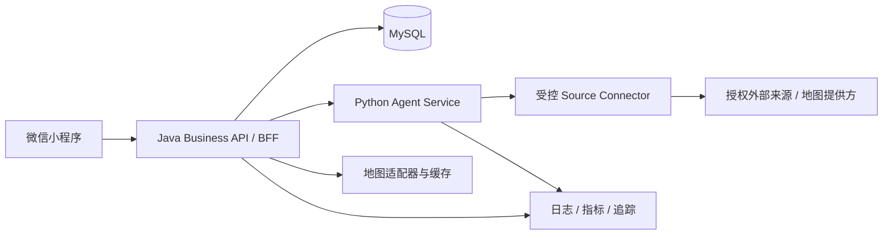
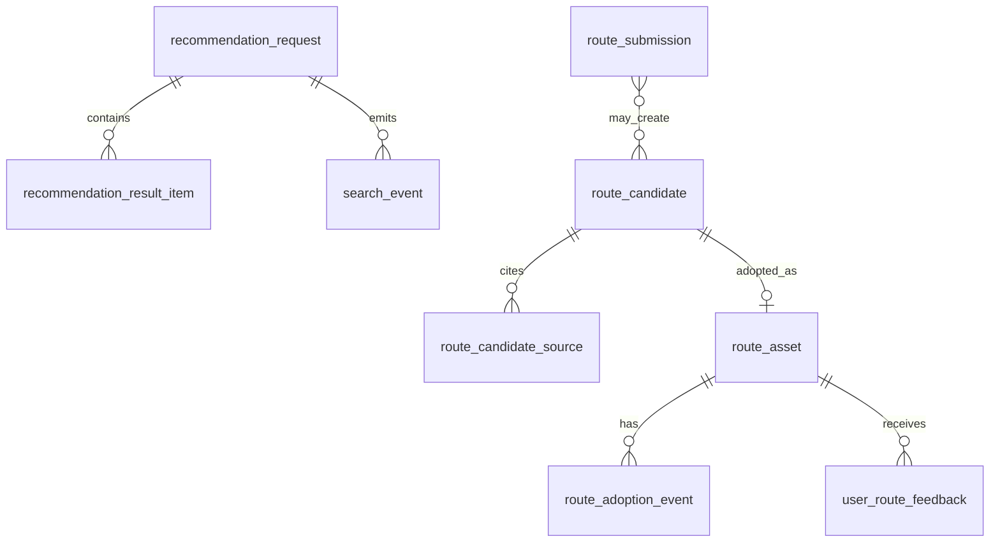

# 后端实现与架构设计：野去原型闭环

日期：2026-09-28；本地实现对照更新：2026-09-29  
状态：目标架构与 B0/B1 本地实现对照稿，独立门禁待评审  
适用原型：`miniprogram/` 四页流程与 `outdoor-recommendation-exploration/` H5 demo  
文档边界：区分设计前基线、本轮本地实现与生产目标；本文更新不执行依赖安装、真实数据库迁移、部署或生产同步，不代表阶段验收通过。

## 1. 设计目标

当前原型已经确定了一个清晰的用户闭环：

```text
一句话输入
→ 带出发地、时间和轻量偏好
→ 查看路线参考、来源、理由和风险
→ 打开地图或详情
→ 加入 / 想去
→ 纠错或补充一条路线
```

后端要支撑这条路径，并守住一期的产品规则：

- 搜索结果先是“候选参考”，不自动变成正式路线；
- 只有用户明确点击“加入”后，才创建正式路线资产；
- 每条候选都要能解释来源、采集时间、匹配理由和待确认项；
- Agent 只负责理解和整理来源，不直接写正式业务数据；
- 结果服务不可用时，小程序仍能明确展示降级状态，不把预览数据冒充真实来源。

## 2. 设计前基线与当前实现

以下为 2026-09-28 设计前的可运行骨架，用于解释改造原因，不再代表当前源码：

| 部件 | 设计前实现 | 目标定位 |
|---|---|---|
| 小程序 | `apiClient.js` 已发送完整诉求、偏好、出发时间和地图点 | 稳定的用户端 API 消费者 |
| Java | 标准库 HTTP 服务，负责搜索包装、采纳和事件占位 | 业务 API、状态和事务的唯一拥有者 |
| Python | 关键词解析和两个 mock 候选 | Agent 编排与来源连接器执行者 |
| MySQL | 六张目标 schema 表，尚未接入运行时 | 正式业务事实源 |
| 本地存储 | `route-adoptions.jsonl` 和小程序本地缓存 | 仅用于当前骨架与离线预览 |
| 部署 | Java Dockerfile 默认访问 `127.0.0.1:19081` | 不能作为 Java/Python 分服务的最终拓扑 |

设计前原型已经调用、但旧 Java 骨架尚未提供的接口包括：

- `GET /api/v1/user/recommendation/{id}`：详情和分享冷启动；
- `POST /api/v1/map/reverse-geocode`：出发地显示；
- `POST /api/v1/user/routes/by-shortline/{id}/feedback`：已采纳路线纠错；
- `POST /api/v1/user/routes`：用户补充路线线索。

设计前 Java 搜索只读取 `query`、`message`、`destinationHint` 和 `originLabel`，会丢掉年龄、时长、难度、交通、车程、场景、安全需求、坐标和出发时间。旧服务使用正则解析 JSON、手工拼接响应，并将采纳直接追加到 JSONL，不能作为生产实现。

2026-09-29 本地源码已经进入以下状态；这是实现对照，不是 code-review、QA、诊断或 reviewer 的验收结论：

| 部件 | 当前本地实现 | 仍待实现或验证 |
|---|---|---|
| Java | Java 17 目标字节码、Spring Boot 3.2.5、Jackson、JDBC 和事务；旧入口转发到新应用，不再写 JSONL | 真实 Java 17 运行时、生产身份认证与授权、规模验证 |
| 本地数据 | `local` profile 使用 H2 文件库，`schema-local.sql` 初始化请求、候选、证据、结果、采纳、反馈、贡献、事件、历史和幂等记录 | H2 的 MySQL 兼容模式不能替代 MySQL 验证 |
| MySQL | `mysql` profile 与 `V001__business_baseline_draft.sql` 草案；禁止自动执行 SQL | 草案面向全新专用库；旧 schema 升级、回填、真实迁移和回滚均 pending |
| Python | 标准库 HTTP 层、类型校验、结构化条件、Connector 协议、证据归一化、去重与有界超时 | 未采用 FastAPI；真实授权来源和生产排序属于 B2 pending |
| 小程序契约 | canonical 路径、稳定幂等键、网络失败同路径重试、搜索预算默认 5 秒 | 真机、部署地址和生产服务验收 |
| 地图与来源 | 无地图 provider 时明确降级；无路线 provider 时正常空结果；显式 demo 不可采纳 | 真实 provider、缓存与来源治理 |
| 生产入口 | Java `production` profile 拒绝启动，MySQL 仅允许明确确认的测试库；Python production 要求内部 token 且禁止 demo | 身份、网关保护、MySQL 与生产部署门禁保持 pending |

## 3. 目标拓扑



运行时所有权固定如下：

1. Java 是小程序唯一后端入口，拥有候选请求、采纳、正式路线、反馈和事件的业务语义。
2. Python 只返回结构化候选、来源证据、匹配理由和不确定项，不持有 MySQL 凭据，不直接发布路线。
3. 生产目标由 MySQL 保存候选快照、采纳事件、正式路线和反馈；当前本地由 H2 实现同一 Repository 边界。
4. 外部来源只能通过受控 Connector 接入，Connector 必须附带来源类型、访问方式、采集时间和证据。
5. 地图反向地理编码属于 Java 的 provider adapter，结果带 provider 和过期时间，不把原始坐标扩散给无关模块。

第一阶段保持两个服务即可。不要先引入消息队列、Redis、独立推荐服务或复杂账户中心；只有搜索量、缓存命中率或异步采集需求证明必要时再拆分。

## 4. Java 业务服务模块

当前 Java 已采用 Java 17 目标、Spring Boot 3.2.5、Jackson、JDBC 与事务，本地使用 H2；MySQL 是待验证的生产存储目标。Python 保留标准库 HTTP 层并显式校验契约，未引入 FastAPI。框架可运行不等于生产就绪，真实数据库、身份与部署须分别验证。

| 模块 | 职责 | 关键规则 |
|---|---|---|
| `search` | 校验诉求、保存请求快照、调用 Agent、保存候选结果 | 完整透传结构化偏好；输出稳定 `requestId` |
| `candidate` | 候选和来源证据查询 | 候选只读参考，必须绑定请求和来源 |
| `route-asset` | 详情、采纳、正式路线状态 | 采纳事务只能由 Java 创建资产 |
| `feedback` | 纠错和用户补充线索 | 反馈先进入待处理，不直接改正式字段 |
| `event` | 搜索、详情、收藏、地图、采纳等行为事件 | append-only；事件失败不阻断主路径 |
| `map` | 反向地理编码和坐标合法化 | provider、缓存 TTL、失败降级可见 |
| `audit` | 请求关联、来源治理和状态历史 | 所有状态变化带 actor、时间和 correlationId |

当前采用 Controller → BusinessService / Contract / Policy → Repository，幂等事务由 IdempotencyService 统一包裹。Controller 不直接写表，Agent adapter 不直接改状态，Repository 不承载产品规则。

## 5. Python Agent 模块

Agent 保留 `/v1/route-candidates` 作为内部接口，输入是推荐所需的结构化条件，输出是包含 `intent/items/status/warnings` 的外壳。匿名会话和幂等键由 Java 保存并用于归属校验，不发给 Agent；Agent 的兼容契约可接受会话字段，不要求调用方提供。目标模块按顺序执行：

1. `IntentParser`：从一句话提取活动类型、人群、时长、难度、场景和安全偏好；
2. `SourcePolicy`：按请求允许的来源类型选择 Connector；
3. `Connector`：只调用已授权来源，设置超时、限流和来源标记；
4. `Normalizer`：统一标题、地点、时间、坐标、事实和风险字段；
5. `Deduplicator`：按地点、名称和来源标识去重，保留多来源证据；
6. `Ranker`：按用户偏好排序，生成 `matchReasons`，不生成绝对安全结论；
7. `EvidenceBuilder`：确保每项候选至少包含一条来源证据，否则降级为不可直接推荐。

当前 `contracts.py`、`candidates.py`、`server.py` 已提供条件校验、Connector、来源开关、证据归一化、去重和稳定顺序 rank。按距离、时长和偏好的生产排序、真实来源接入仍待 B2。默认未配置 provider，返回 `NO_SEARCH_RESULTS`、空 `items` 和 `SOURCE_NOT_CONFIGURED`；失败或超时返回 `DEGRADED`。只有 `AGENT_DEMO_MODE=true` 才启用 `LOCAL_PREVIEW/MOCK`，并标记 `previewOnly:true`、`adoptionRequired:false`，Java 拒绝其创建正式资产。

未来 Java 可从已采纳且允许复用的正式路线资产中生成有限降级参考；当前尚未实现该回退，不把缓存、mock 或预览声称为真实推荐。

## 6. 统一请求和响应契约

### 6.1 搜索请求

`POST /api/v1/user/search/recommendations`

```json
{
  "clientRequestId": "client_01J...",
  "query": "周末带孩子走一条轻松的自然步道",
  "origin": {
    "label": "深圳",
    "city": "深圳",
    "lng": 114.0579,
    "lat": 22.5431,
    "source": "wx_location"
  },
  "preferences": {
    "ageRange": "6-10岁",
    "duration": "半天",
    "difficulty": "轻松",
    "transport": "自驾",
    "driveLimitMinutes": 45,
    "scenePreferences": ["公园", "绿道"],
    "safetyNeeds": ["厕所方便", "停车方便", "可随时折返"]
  },
  "departureTime": {
    "mode": "TODAY_PM",
    "iso": "2026-09-28T07:00:00.000Z",
    "timezone": "Asia/Shanghai"
  },
  "sourcePolicy": {
    "includeSystem": true,
    "includeMap": true,
    "includeGuide": true,
    "includeUserShared": true,
    "limit": 10
  },
  "anonymousSessionId": "session_xxx"
}
```

服务端必须保存请求快照和 `criteriaVersion`，不能只保存一段 query。坐标缺失或不在中国范围时，只使用 `origin.label`，不把无效点传给地图或 Agent。

当前 Java 保存匿名会话归属和规范化条件快照，向 Agent 传送 `requestId/query/origin/preferences/departureTime/sourcePolicy` 等推荐必要字段；会话和幂等键停留在业务边界。嵌套条件优先于旧扁平字段。Java 与 Python 的输入范围应保持一致，跨服务边界值以契约回归确认。

### 6.2 搜索响应

```json
{
  "ok": true,
  "requestId": "req_xxx",
  "status": "READY",
  "resultType": "CANDIDATE_REFERENCE",
  "items": [
    {
      "candidateId": "cand_xxx",
      "id": "cand_xxx",
      "rank": 1,
      "title": "近郊亲子自然步道",
      "subtitle": "适合半天轻户外",
      "sourceType": "GUIDE_PUBLIC",
      "sourceLabel": "公开攻略来源整理",
      "collectedAt": "2026-09-28T08:00:00Z",
      "sourceEvidence": [
        {
          "sourceId": "src_xxx",
          "type": "GUIDE_PUBLIC",
          "label": "公开攻略来源整理",
          "url": "https://example.invalid/source",
          "accessMode": "AUTHORIZED_API",
          "collectedAt": "2026-09-28T08:00:00Z",
          "expiresAt": "2026-10-05T08:00:00Z"
        }
      ],
      "matchReasons": ["适合亲子", "强度较低"],
      "routeStats": {
        "driveTimeText": "从深圳出发约 30-60 分钟",
        "walkDistanceText": "轻量步行参考",
        "childDurationText": "建议半日内完成"
      },
      "geo": {
        "name": "路线入口",
        "address": "深圳周边",
        "lng": 114.0579,
        "lat": 22.5431
      },
      "missingItems": ["开放状态需出发前确认"],
      "riskWarnings": ["停车和厕所信息需现场确认"],
      "adoptionRequired": true
    }
  ],
  "warnings": [],
  "nextActions": ["查看来源和匹配理由", "确认后点击加入"],
  "generatedAt": "2026-09-28T08:00:01Z"
}
```

上述带路线的响应是来源契约示例，不表示当前已配置真实来源。`candidateId` 和 `routeAssetId` 必须分开，由 Java 生成业务标识；现有客户端 `id` 兼容相应详情类型，服务端表和采纳接口使用显式字段。无 provider 的正常空结果为 `NO_SEARCH_RESULTS`；调用失败、超时、证据降级或 demo 为 `DEGRADED`，不能自动补入假路线。

### 6.3 详情、采纳、反馈和贡献

| 方法 | Canonical API | 用途 | 写入规则 |
|---|---|---|---|
| GET | `/api/v1/user/candidates/{candidateId}` | 候选快照详情 | 只读公开字段，不回传 query、会话或私人备注 |
| GET | `/api/v1/user/routes/{routeAssetId}` | 正式路线详情 | 与候选详情分开，返回 `routeAssetId` |
| POST | `/api/v1/user/routes/adoptions` | 候选加入我的路线 | 一个事务创建 `route_asset` 和 `route_adoption_event` |
| POST | `/api/v1/user/search/events` | 点击、详情、收藏、地图等事件 | append-only，不创建正式资产 |
| POST | `/api/v1/user/route-feedback` | 候选或正式路线纠错 | 候选必须匹配原 request/session；公开资产允许查看者反馈，状态 `RECEIVED` |
| POST | `/api/v1/user/routes/{routeAssetId}/feedback` | 正式资产反馈兼容入口 | 与上述反馈同一 operation，路径资产 ID 必须一致 |
| POST | `/api/v1/user/route-submissions` | 用户补充路线线索 | 最少 `title/startPoint`，写入 `REVIEW_PENDING`，不直接发布 |
| POST | `/api/v1/map/reverse-geocode` | 出发地反向地理编码 | 当前无 provider，返回 `DEGRADED/label/provider:null`；真实缓存与证据待接入 |

保留旧 `/api/user/...`、`/user/recommendation/{id}`、投稿 `/user/routes` 和 by-shortline 反馈等迁移别名；新客户端使用 `/api/v1` canonical 路径。当前所有 POST 需要匿名会话（header 或 body）和 `Idempotency-Key`（或 `clientRequestId`）。客户端网络失败最多在同一路径、同一 body 和 key、剩余总预算内重试一次，不把 HTTP 错误转向其他别名。

幂等作用域为 `(session, operation, key)`，不是全局 key。相同作用域和请求体复用原 HTTP 状态、body 与业务 ID；不同请求体返回 `409 IDEMPOTENCY_CONFLICT`。兼容别名与 canonical 共享 operation。

候选反馈携带 `requestId/candidateId` 并核对原会话；公开资产反馈携带 `routeAssetId`，不要求拥有创建该资产的搜索，携带的原搜索 ID 不作为查看者归属。匿名会话目前只是本地归属标识，不是可信身份。投稿最少要求 `title/startPoint`，`endPoint/tags/note/shareExperience` 可选；反馈至少有一个 tag 或 note。私人备注没有公开查询接口，投稿不能自动成为正式路线。

### 6.4 错误模型

所有接口使用同一错误外壳，业务错误不靠 HTTP 文案猜测：

```json
{
  "ok": false,
  "error": {
    "code": "AGENT_TIMEOUT",
    "message": "路线参考暂时不完整，请稍后再试。",
    "retryable": true
  },
  "requestId": "req_xxx",
  "correlationId": "corr_xxx"
}
```

业务错误包括 `INVALID_REQUEST`、`ORIGIN_INVALID`、`CANDIDATE_NOT_FOUND`、`CANDIDATE_NOT_OWNED_BY_REQUEST`、`CANDIDATE_EXPIRED`、`CANDIDATE_DISABLED`、`CANDIDATE_NOT_ADOPTABLE`、`ROUTE_ASSET_NOT_FOUND`、`IDEMPOTENCY_CONFLICT`、`REQUEST_IN_PROGRESS`、`RATE_LIMITED` 和 `INTERNAL_ERROR`。同键同体重放是原成功响应，不使用 `ADOPTION_IDEMPOTENT_REPLAY` 错误。`AGENT_TIMEOUT/SOURCE_DEGRADED` 可作为搜索降级的 warnings。可恢复错误带 `retryable`，不暴露 Java/Python 堆栈或来源密钥。

## 7. 关键数据模型

设计前六张表是历史起点；当前 H2 schema 已提供以下业务关系，MySQL 草案另行验证：



### 必要表

- `recommendation_request`：自然语言、结构化条件、匿名会话、来源策略、状态和版本；
- `recommendation_result` / `recommendation_result_item`：一次搜索返回的排序快照，避免外部来源变化后详情无法复现；
- `route_candidate`：候选的业务字段、状态和原始归一化 payload；
- `route_candidate_source`：来源、访问方式、来源标识、采集/过期时间和证据 payload；
- `route_asset`：明确采纳后的正式资产，包含状态、推荐开关、规范化地点和事实；
- `route_adoption_event`：采纳动作、请求、会话和上下文；请求幂等存放独立 `idempotency_record`；
- `search_event`：结果点击、详情、收藏、地图打开、采纳和反馈提交等 append-only 行为；
- `user_route_feedback`：已采纳路线的纠错内容和处理状态；
- `route_submission`：用户补充线索及审核状态；
- `business_status_history`：当前统一记录正式资产、反馈和贡献等状态；更完整来源治理历史仍属后续范围；
- `idempotency_record`：会话、operation、key、请求 hash、HTTP 状态和响应快照。

### 约束

- `route_candidate(request_id, candidate_id)` 唯一；
- `idempotency_record(session_id, operation, idem_key)` 联合主键；
- `route_adoption_event(candidate_id, session_id)` 唯一；
- `route_asset(candidate_id)` 唯一，重复采纳返回既有 `routeAssetId`；
- 采纳前必须确认 candidate 属于 request、未过期、存在来源证据且未被禁用；
- 搜索事件不改变正式资产状态；
- 用户提交默认 `REVIEW_PENDING`，不可直接参与公开推荐；
- 原始来源 payload 只保存必要字段，个人备注和坐标按最小化原则处理。

## 8. 主流程和失败策略

### 搜索

1. Java 校验和生成 `requestId`，保存请求快照；
2. 在总预算内调用 Agent，完整传递偏好和来源策略；
3. Java 校验 Agent 输出的 schema、来源证据和坐标范围；
4. 保存候选及来源，再生成结果排序快照；
5. 返回 `READY`、`DEGRADED` 或 `NO_SEARCH_RESULTS`，不把内部异常直接暴露给用户。

当前搜索总预算默认客户端 5 秒（含同路径网络重试），Java 等待 Agent 1.2 秒，Python Connector 总预算 1 秒。Java 使用 4 个调用 worker、容量 8 的队列，连续失败后短暂熔断；Python 对未完成 Connector 限制 8 个 worker 槽位。当前未实现慢来源异步刷新或正式资产缓存回退。其他客户端接口的默认请求超时为 12 秒，不与搜索预算混写。

### 采纳

在一个数据库事务内：登记 `(session, operation, key)` → 锁定候选 → 校验 request/session/证据、状态、过期和非预览 → 创建或读取 `route_asset` → 写 `route_adoption_event`、状态历史和幂等响应 → 提交。网络重试命中同作用域、同键同体时返回首次结果。不同 key 对同一候选也受候选唯一约束保护。新资产 `recommendation_enabled=false`，采纳不自动等于允许公开推荐。

### 反馈和用户补充

反馈先入库并返回 `RECEIVED`，后台治理再决定是否更新正式事实。候选反馈核对原 request/session，公开正式资产允许查看者反馈。用户补充路线以 `title/startPoint` 为最小输入，进入 `REVIEW_PENDING`；审核、来源核验和转为候选的流程仍待治理实现，不直接创建正式资产。写入失败可以保留本地草稿，但必须明确“仅本机保存”，不得显示服务器已收到。

### 外部来源失败

未配置 provider 或正常搜索无结果时返回 `NO_SEARCH_RESULTS`；Connector 失败、超时或无效证据返回 `DEGRADED`，若仍有有效候选可伴随降级返回。显式 demo 返回预览且不能采纳。正常空结果和异常降级都不会自动触发假来源。

## 9. 部署和安全边界

生产目标采用三个运行单元：Java Business API、Python Agent、MySQL。Java 的 `AGENT_BASE_URL` 必须是云内服务地址或服务发现地址，并通过服务令牌鉴权；不能继续使用 `127.0.0.1:19081`，除非明确实现同容器 sidecar。

当前默认只面向 loopback 本地运行。Java 的 production profile 拒启动；mysql profile 需要明确测试库确认且不自动初始化。Python production 必须提供 `AGENT_INTERNAL_TOKEN` 并禁止 demo；Java `AGENT_SERVICE_TOKEN` 用于对应 Bearer 鉴权。这些保护不等同于完整生产身份方案；真实身份、MySQL 迁移与生产部署保持 pending。

- 小程序只访问 Java 的云服务名；
- Java → Agent 使用短超时、重试上限、熔断和 correlationId；
- Agent 不拥有 MySQL、正式路线发布或用户反馈写权限；
- 外部来源密钥只注入 Connector 运行环境，不写入小程序、日志或候选正文；
- 匿名会话只作为幂等和行为关联键，不把它当作认证身份；
- 搜索、贡献和反馈接口按匿名会话限流，输入长度、坐标、数组数量和来源策略都要校验；
- 生产日志必须脱敏 query、备注、坐标，并保留 `requestId/candidateId/routeAssetId` 关联；
- 个人信息、来源授权和删除策略在真实部署前另行确认。

## 10. 实施分期

下列是阶段目标，不是本轮完成清单。B0/B1 已有本地实现供独立审查；B1 的真实 MySQL、B2 授权来源与生产排序、B3 完整治理和 B4 部署仍待执行。任务勾选和放行由独立门禁证据决定，本文不提前宣布通过。

### B0：契约冻结与安全修正

- 冻结 `RecommendationRequest`、候选、详情、采纳、事件、反馈、贡献和地图响应 schema；
- Java 改为结构化 JSON 解析和统一错误码；
- 完整透传当前原型的偏好字段；
- Canonical 路径统一为 `/api/v1`，旧路径只做兼容；
- 为所有副作用 POST 加 `clientRequestId/Idempotency-Key`；
- 为 Agent 调用加入线程池、总超时、熔断和 correlationId。

### B1：Java + MySQL 业务闭环

- 以 Spring Boot 或等价生产框架替换标准库 HTTP 骨架；
- 建立 Repository 和 SQL migration，先写 request/candidate/result/source/asset/adoption/event/feedback/submission；
- 实现采纳事务和唯一约束；
- 实现详情、反馈、用户补充和反向地理编码接口；
- 将旧 JSONL 视为迁移输入，不再作为事实源。

### B2：Agent 生产接口

- 引入结构化 intent、Connector interface、schema 校验、来源证据和去重；
- 接入首个明确授权的来源，保留 mock connector 作为契约测试；
- 对慢来源采用并行执行和有限结果回退；
- Agent 运行审计只记录到受控运行表或日志，不写正式业务表。

### B3：可观测性与治理

- 建立请求耗时、Agent/Connector 成功率、来源证据完整率、采纳率和反馈处理时长指标；
- 增加来源过期、冲突、禁用和人工复核状态；
- 增加契约测试、幂等重试测试、候选污染防护测试和故障降级测试。

### B4：部署前验收

- 分别构建 Java/Agent 镜像，配置云内地址和服务鉴权；
- 使用测试 MySQL 执行 migration 和回滚演练；
- 小程序真机完成搜索、详情冷启动、地图、加入、纠错和分享路线验收；
- 通过 QA、诊断和 reviewer 后，再由用户单独授权依赖安装、数据库变更和部署。

## 11. 验收标准

后端实现达到下一阶段放行前，至少满足：

1. 原型发出的所有 canonical 请求都有明确响应 schema 和错误码；
2. 搜索条件完整透传，结果包含来源证据、更新时间、理由、事实、地图点和待确认项；
3. 候选详情可在冷启动和分享路径访问；
4. 未采纳候选不出现在 `route_asset`；
5. 重试采纳只返回一个 `routeAssetId`；
6. 事件、反馈、用户补充均可持久化或明确返回可追踪的降级状态；
7. Agent 没有 MySQL 写权限；
8. Connector 未授权或证据不足时不会进入可发布候选；
9. Java/Agent 分服务部署地址可配置，不依赖 loopback 假设；
10. 搜索超时、单来源失败、MySQL 不可用均有可验证的降级和告警路径。

## 12. 反向思考卡

| 可能的错误方向 | 纠偏决定 | 边界 |
|---|---|---|
| 一开始拆成很多微服务 | 第一阶段只保留 Java、Python、MySQL 三个运行单元 | 规模和异步采集证明需要时再拆 |
| 让 Agent 直接写库 | Agent 只读编排，Java 负责业务事务 | 来源运行审计也不等于正式资产 |
| 为了速度继续用 JSONL | 当前运行时已改 H2/JDBC，旧 JSONL 只作为未来迁移输入 | H2 事务不能替代真实 MySQL 迁移与回滚验证 |
| 对 POST 逐路径盲目重试 | canonical 路径 + 幂等键 + 结果复用 | 兼容别名只用于迁移期 |
| 把 mock 或缓存说成真实推荐 | 明确 `DEGRADED/LOCAL_PREVIEW`，标注来源和过期 | release 不得伪造外部证据 |
| 先接所有外部平台 | 先接一个明确授权且可重复验证的来源 | 每个平台单独评估权限、稳定性和证据 |
| 先上复杂推荐算法 | 先保证来源、结构化事实、理由和采纳闭环 | 算法优化后置到有行为数据之后 |

## 13. 设计结论

当前原型已经形成 B0/B1 本地实现：Spring Boot/JDBC/H2 业务事务、Python 标准库 Agent 契约及小程序调用适配已可供审查。未发现阻塞本次文档对齐的问题；独立代码审查、QA、诊断和 reviewer 结论由对应岗位给出。真实 MySQL、来源授权、生产排序、可信身份与部署仍 pending，不得据本地实现声称真实生产闭环已经完成。
