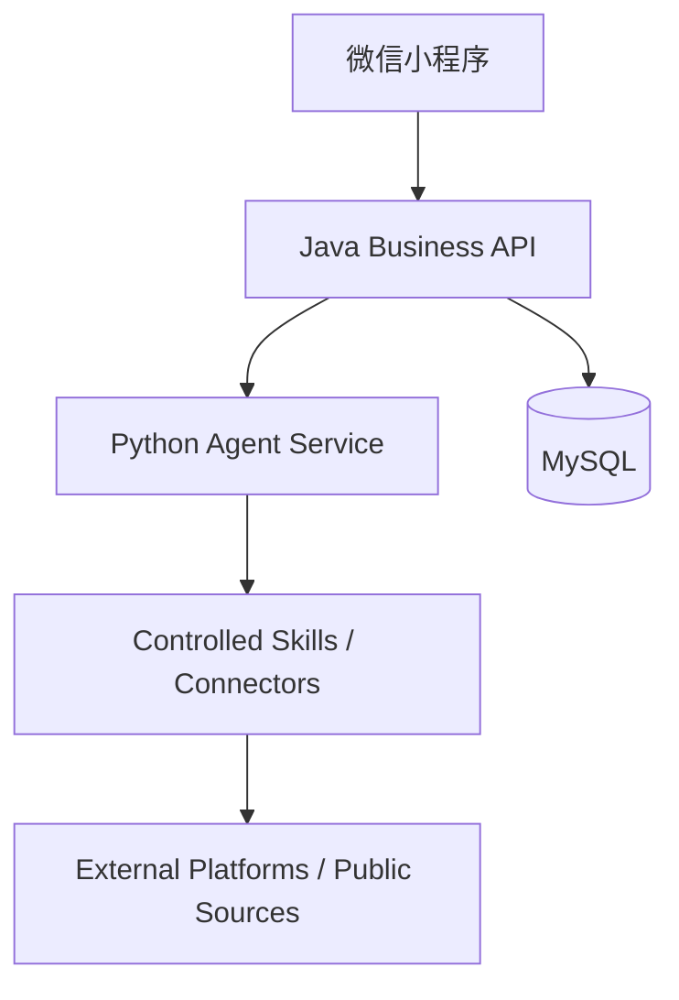

# 架构设计：一期微服务与 Agent 架构

日期：2026-09-24  
主导岗位：architect  
状态：v1 / 本轮开发输入

## 1. 架构原则

- 用户端使用当前微信小程序实现；
- 业务系统使用 Java；
- Agent 使用 Python；
- 数据库目标使用 MySQL；
- 最终后台通过 Dockerfile 部署到微信云托管；
- 文档驱动，不跳过产品、架构、设计、测试文档；
- 外部平台信息必须合法、可追溯、可审计。

## 2. 服务拆分



## 3. 服务职责

### Java Business API

- 对小程序提供稳定 API；
- 维护业务语义：候选、采纳、正式路线资产；
- 决定哪些数据可以写入正式资产；
- 写入 MySQL；
- 提供健康检查和采纳接口。

### Python Agent Service

- 理解一句自然语言诉求；
- 将诉求转为来源检索任务；
- 调用受控 Skill / Connector；
- 生成候选路线参考；
- 不直接写 MySQL；
- 不决定正式路线资产。

### MySQL

- 保存候选请求快照；
- 保存候选来源和证据；
- 保存用户采纳事件；
- 保存正式路线资产；
- 保存反馈和审计。

## 4. API 契约

### 推荐候选

`POST /api/user/search/recommendations`

输入：

```json
{
  "query": "周末带孩子找一条轻松自然步道",
  "originLabel": "深圳",
  "anonymousSessionId": "optional"
}
```

输出：

```json
{
  "ok": true,
  "requestId": "req_xxx",
  "status": "READY",
  "items": [
    {
      "id": "cand_xxx",
      "title": "候选路线",
      "sourceType": "SKILL_PUBLIC",
      "sourceLabel": "受控来源整理",
      "collectedAt": "2026-09-24T00:00:00Z",
      "matchReasons": ["适合亲子", "强度较低"],
      "rawRef": {
        "candidateId": "cand_xxx",
        "adoptionRequired": true,
        "sources": []
      }
    }
  ]
}
```

### 采纳路线

`POST /api/user/routes/adoptions`

输入：

```json
{
  "requestId": "req_xxx",
  "candidateId": "cand_xxx",
  "anonymousSessionId": "optional"
}
```

输出：

```json
{
  "ok": true,
  "routeAssetId": "route_xxx",
  "status": "ADOPTED"
}
```

## 5. 本轮实现取舍

为避免安装依赖和数据库变更门禁，本轮先实现：

- Java 标准库 HTTP 服务；
- Python 标准库 HTTP 服务；
- 文件型本地存根保存采纳结果；
- MySQL schema 文档和 SQL；
- Dockerfile；
- 本地脚本验证。

后续可在授权后替换为：

- Java Spring Boot；
- Python FastAPI；
- 真实 MySQL Repository；
- 微信云托管部署。

## 6. 风险

| 风险 | 影响 | 缓解 |
|---|---|---|
| 外部平台授权不明确 | 不能接真实数据 | 先用受控 mock connector，逐平台确认 |
| 候选污染正式资产 | 推荐质量下降 | 必须用户明确采纳 |
| 微服务过早复杂化 | 开发成本上升 | 一期只保留 Java + Python 双服务 |
| 未部署微信云 | 无法证明生产可用 | 本轮只给 Dockerfile 和人工验收入口 |
